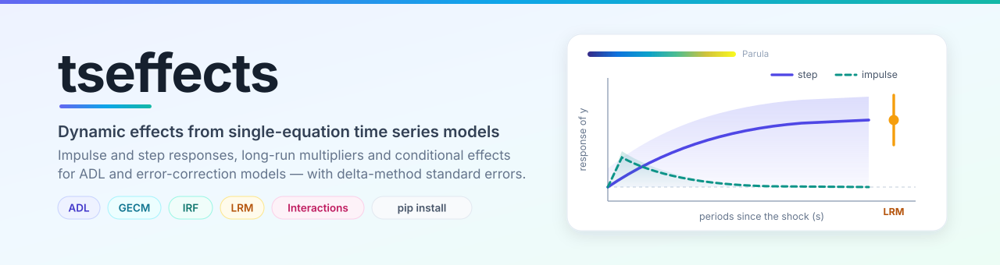
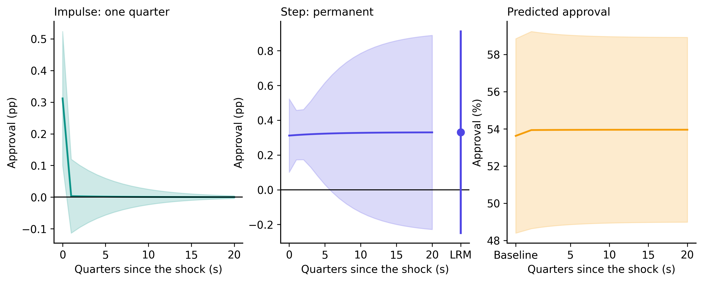
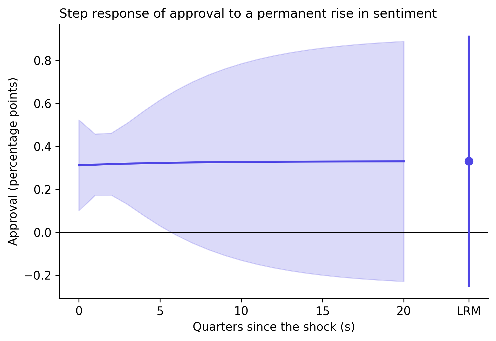
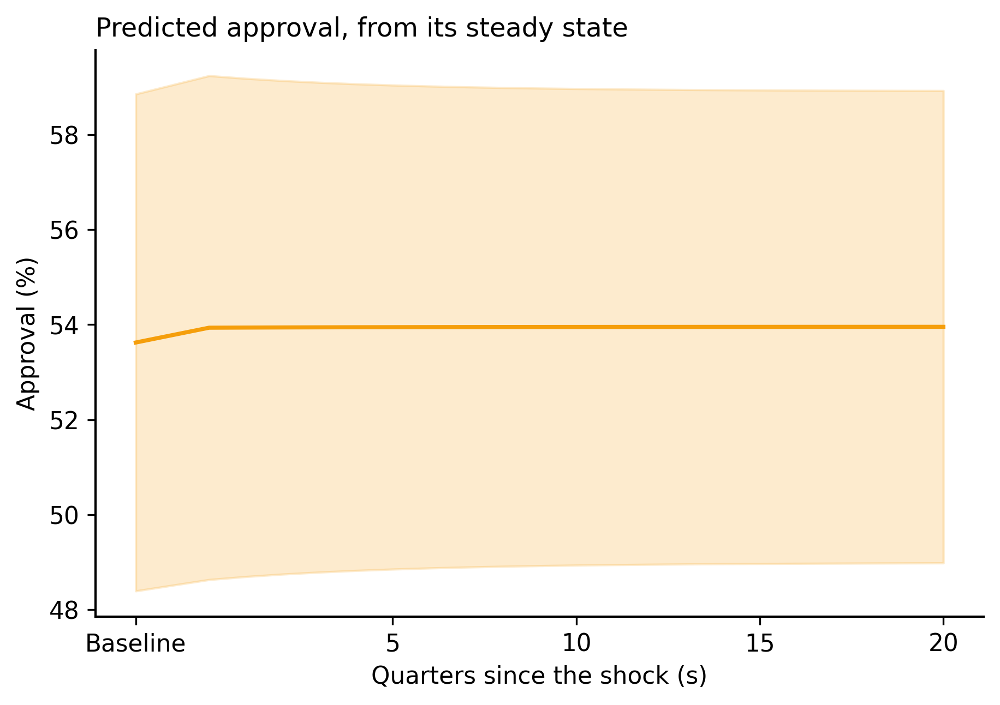
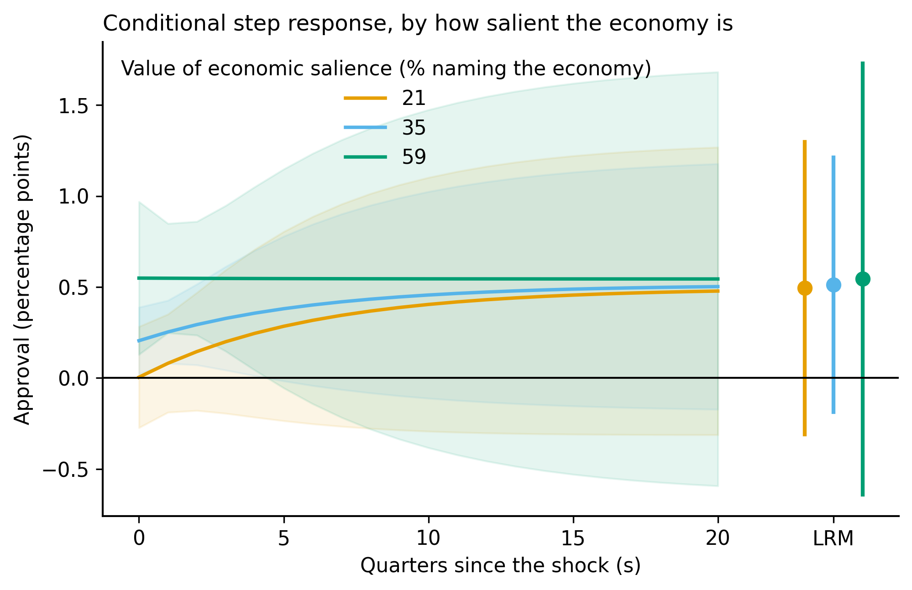

<p align="center">
  
</p>

<p align="center">
  <a href="https://pypi.org/project/tseffects/"></a>
  <a href="https://pypi.org/project/tseffects/"></a>
  <a href="LICENSE"></a>
  <a href="https://merwanroudane.github.io/tsseffect/"></a>
</p>

<p align="center">
  <b><a href="https://merwanroudane.github.io/tsseffect/">Documentation</a></b> ·
  <a href="https://pypi.org/project/tseffects/">PyPI</a> ·
  <a href="https://github.com/merwanroudane/tsseffect">GitHub</a> ·
  <a href="https://doi.org/10.1017/psrm.2026.10087">The method paper</a>
</p>

---

## The problem this solves

Here is a real coefficient table — US presidential approval on consumer sentiment,
1981–2015, from the data shipped with this package:

```
                 coef    std err       t      P>|t|
l_1_APPROVE    0.8385      0.044  19.182      0.000
UMCSENT        0.3118      0.087   3.595      0.000
l_1_UMCSENT   -0.2584      0.087  -2.972      0.004
```

The two sentiment coefficients almost cancel: **+0.31 and −0.26, a net +0.05**. A
reader stops here and concludes that consumer sentiment barely moves approval.

That reader is wrong by a factor of six. Because approval carries 0.84 of itself
forward each quarter, a *permanent* one-point rise in sentiment raises approval by
**+0.33 points**, not +0.05. And there is a second thing the coefficient table cannot
tell you: that effect is significant at the 1 % level for the first year, and by the
long run its confidence interval covers zero.

You cannot read either fact off the coefficients. You need the **response function**,
and you need its standard errors. That is what this package computes.

```python
step = gdrf_adl(fit, x_vrbl={"UMCSENT": 0, "l_1_UMCSENT": 1},
                y_vrbl={"l_1_APPROVE": 1}, shock_history="step", se_type="HC3")
step.summary()
```

<p align="center">
  
</p>

---

## Contents

- [Install](#install)
- [Start from absolutely nothing](#start-from-absolutely-nothing) — for readers who have never used Python
- [The 60-second example](#the-60-second-example)
- [The idea](#the-idea)
- [Full syntax reference](#full-syntax-reference)
- [The complete real-data walkthrough](#the-complete-real-data-walkthrough)
- [Interpreting the output](#interpreting-the-output)
- [Practical guidance](#practical-guidance)
- [Performance](#performance)
- [Validation](#validation)
- [References](#method-references)
- [Credit and licence](#credit-and-licence)

---

## Install

```bash
pip install tseffects
```

Needs Python 3.9 or newer. It will pull in `numpy`, `scipy`, `pandas`, `sympy`,
`statsmodels` and `matplotlib`.

---

## Start from absolutely nothing

*Skip this if you already use Python.* Written for someone who has never typed a
command in their life.

**1. Install Python.** Download the Anaconda distribution from
<https://www.anaconda.com/download>. It bundles Python with the scientific libraries
and a notebook editor. Run the installer and accept the defaults.

**2. Open a place to type commands.**

- *Windows:* press the Start key, type `Anaconda Prompt`, press Enter.
- *macOS:* press ⌘ + Space, type `Terminal`, press Enter.

A window opens with a blinking cursor. This is where commands go.

**3. Install the package.** Type this and press Enter:

```bash
pip install tseffects
```

Wait for it to finish. You only ever do this once.

**4. Check it worked.**

```bash
python -c "import tseffects; print(tseffects.__version__)"
```

A version number means you are ready.

**5. Write your first analysis.** Open the Anaconda Navigator and launch **Jupyter
Notebook** (good for exploring, one block at a time) or **Spyder** (good for writing a
whole script). Paste the [60-second example](#the-60-second-example) into a cell and
press Shift + Enter.

**6. Load your own data.** If your data is in Excel or CSV:

```python
import pandas as pd

data = pd.read_excel("C:/Users/you/Documents/mydata.xlsx")   # or
data = pd.read_csv("C:/Users/you/Documents/mydata.csv")
print(data.head())
```

Use forward slashes `/` in the path even on Windows, or Python will misread the
backslashes.

**7. Build the lags you need.** A dynamic model needs the lagged series as actual
columns. Sort by time first, then:

```python
data = data.sort_values("date").reset_index(drop=True)

data["l_1_y"] = data["y"].shift(1)      # y at t-1
data["l_1_x"] = data["x"].shift(1)      # x at t-1
data["d_y"]   = data["y"].diff()        # the first difference of y
data["d_x"]   = data["x"].diff()

data = data.dropna(subset=["y", "l_1_y", "x", "l_1_x"]).reset_index(drop=True)
```

The last line drops the first row, which has no lag. **Drop missing values only on the
columns your model uses** — `data.dropna()` with no arguments throws away rows over
unrelated columns and silently changes your sample.

Whatever you name these columns is what you will pass to the package. There is no
required naming convention.

---

## The 60-second example

```python
import statsmodels.formula.api as smf
from tseffects import load_toy_data, gdrf_adl

data = load_toy_data()

# 1. Estimate the model yourself, however you like. It is just OLS.
fit = smf.ols("y ~ l_1_y + x + l_1_x", data=data).fit()

# 2. Tell the package which coefficient sits at which lag.
out = gdrf_adl(
    fit,
    x_vrbl={"x": 0, "l_1_x": 1},   # the shock variable and its lags
    y_vrbl={"l_1_y": 1},           # the lagged dependent variable
    shock_history="step",          # a permanent one-unit rise in x
    s_limit=20,                    # report 20 periods
)

print(out.summary())       # the table
out.plot()                 # the figure
out.formulae["s = 2"]      # the algebra behind period 2
```

That is the whole interface. You estimate the model; you describe its lag structure;
the package does the dynamics.

---

## The idea

Everything is built from two quantities:

- the **Impulse Response Function** — x rises by one unit for one period, then returns;
- the **Step Response Function** — x rises by one unit and stays there.

These are two members of one family, the **General Dynamic Response Function**, indexed
by the order of the shock history `h` and the orders of differencing `d_x` and `d_y`:

$$\mathrm{GDRF}_{(s,\,h,\,d_y,\,d_x)} = \sum_{j=0}^{s} w_j(h, d_x, d_y)\,\xi_{s-j}$$

where $\xi_s$ is the period-$s$ impulse response — itself the recursion
$\xi_s = \beta_s + \sum_i \alpha_i \xi_{s-i}$ — and the weights $w_j$ are generalized
binomial coefficients in $m = h - d_x + d_y$. Setting $m = -1$ gives the impulse
response, $m = 0$ the step response, $m = 1$ its cumulation, $m = -2$ a first
difference. Arbitrary shock histories work too, since any history decomposes into a sum
of dated impulses.

The design choice that makes the whole thing hang together: **every quantity is built
as an algebraic formula in your coefficient names first**, and only then evaluated by
the delta method. One standard-error machinery therefore covers impulse responses,
cumulated responses, long-run multipliers, fitted trajectories and conditional effects
alike — and you can always read the formula behind any number:

```python
>>> out.formulae["s = 2"]
'l_1_x*l_1_y + l_1_y**2*x'
```

---

## Full syntax reference

### `gdrf_adl(model, x_vrbl, y_vrbl=None, ...)`

Dynamic effects from an autoregressive distributed lag model.

| Argument | Type | Default | What it does |
|---|---|---|---|
| `model` | statsmodels result, or `(coef, vcov)` | — | Your fitted OLS model |
| `x_vrbl` | dict | — | `{coefficient name: lag order}` for the shock variable |
| `y_vrbl` | dict or `None` | `None` | `{name: lag}` for the lagged dependent variable |
| `d_x`, `d_y` | int | `0` | How many times each variable was differenced before estimation |
| `shock_history` | `"pulse"`, `"step"`, int, or sequence | `"pulse"` | What happens to x. An integer is the order `h`; a sequence of length `s_limit + 1` is an arbitrary history |
| `inferences_x` | `"levels"` / `"differences"` | `"levels"` | Whether the shock is *applied* in levels or differences |
| `inferences_y` | `"levels"` / `"differences"` | `"levels"` | Whether the response is *read* in levels or differences |
| `effect_type` | `"discrete"` / `"fitted"` | `"discrete"` | The effect itself, or the trajectory of y |
| `cumulative` | bool | `False` | Accumulate the effects over periods |
| `prediction_values` | dict | `None` | Where to hold the other regressors for a steady-state baseline |
| `baseline_y` | float | `None` | An asserted baseline level of y |
| `baseline_y_se` | float | `0.0` | Its standard error, added in quadrature |
| `shock_size` | float | `1.0` | Size of the shock, in the units of x |
| `level` | float | `0.95` | Confidence level |
| `s_limit` | int | `20` | Number of periods to report |
| `se_type` | str | `"const"` | `"const"`, or `"HC0"`–`"HC5"` |
| `return_lrm` | bool | `True` | Report the long-run multiplier when it exists |

### `gdrf_gecm(model, x_vrbl, y_vrbl, x_d_vrbl, y_d_vrbl=None, ...)`

The same, for a Generalized Error-Correction Model. `x_vrbl` and `y_vrbl` are the
**first lag in levels** (the error-correction terms, one each); `x_d_vrbl` and
`y_d_vrbl` are the differenced terms and their lags. Everything else is as above,
except that `prediction_values` is not available — use `baseline_y`.

### `interact_adl(model, x_vrbl, z_vrbl, x_z_vrbl, y_vrbl=None, ...)`

Conditional effects from a model carrying `x × z`. For `x_z_vrbl` the lag order is the
one on the **x** side of the product: `x_l_1_z` (contemporaneous x times lagged z) is
`0`, and `z_l_1_x` (lagged x times contemporaneous z) is `1`.

| Extra argument | Default | What it does |
|---|---|---|
| `plot_type` | `"lines"` | `"lines"` or `"heatmap"` |
| `line_options` | `"z.lines"` | `"z.lines"` (period on x, one line per z) or `"s.lines"` (z on x, one line per period) |
| `heatmap_options` | `"significant"` | `"significant"` blanks the cells whose CI covers zero; `"all"` shows everything |
| `z_vals` | `None` | Up to five values for `z.lines`; exactly two (lower, upper) for a swept range |
| `s_vals` | `(0, "LRM")` | Periods to draw for `s.lines` |
| `z_label` | first `z_vrbl` name | Axis label for the moderator |

### What comes back

Every function returns an `EffectResult`:

| | |
|---|---|
| `.estimates` | a `DataFrame`: `Period`, the effect, `SE`, `Lower`, `Upper` (and `Z` for an interaction) |
| `.to_frame()` | the same plus `z`, `p` and significance stars |
| `.summary()` | an aligned table; also `.as_latex()`, `.as_markdown()`, `.as_html()` |
| `.formulae` | the algebra behind each row |
| `.shocks` | the weights applied to the impulse responses |
| `.lrm` | the long-run multiplier row, or `None` |
| `.plot()` | the figure; returns the matplotlib axes |

### Simple wrappers

`adl_effects(model, x_vrbl, y_vrbl, ...)` and `gecm_effects(...)` cover the common case
— everything in levels, discrete effects — with fewer arguments.

### Colour scales

`parula_colors(n)`, `parula_cmap()`, `matlab_jet_colors`, `turbo_colors`,
`bluered_colors`, `sinha_colors`, and `resolve_colorscale("Parula")` for a plotly
colorscale. Parula is the default on surfaces and heatmaps; a diverging effect surface
centred on zero uses blue–white–red so that zero reads as white.

---

## The complete real-data walkthrough

The full script is [`examples/approval_empirical.py`](examples/approval_empirical.py).
Run it with `python examples/approval_empirical.py` — it regenerates every figure in
this README.

**The data.** Presidential approval, consumer sentiment and economic salience, 139
quarters from 1981Q2 to 2015Q4. From Cavari, Amnon (2019), *Presidential Studies
Quarterly* 49(4): 798–826, [doi:10.1111/psq.12594](https://doi.org/10.1111/psq.12594).
Shipped with the package.

**Step 1 — build the lags.**

```python
import pandas as pd, statsmodels.formula.api as smf
import tseffects as ts

data = ts.load_approval().copy()
for name in ("APPROVE", "UMCSENT"):
    data[f"l_1_{name}"] = data[name].shift(1)
    data[f"d_{name}"]   = data[name].diff()

data = data.dropna(subset=["APPROVE", "l_1_APPROVE", "d_APPROVE", "UMCSENT",
                           "l_1_UMCSENT", "d_UMCSENT", "DIVIDEDGOV"]).reset_index(drop=True)
```

**Step 2 — estimate the ADL(1,1).**

```python
fit = smf.ols("APPROVE ~ l_1_APPROVE + UMCSENT + l_1_UMCSENT + DIVIDEDGOV",
              data=data).fit()
```

**Step 3 — the step response.**

```python
step = ts.gdrf_adl(fit,
                   x_vrbl={"UMCSENT": 0, "l_1_UMCSENT": 1},
                   y_vrbl={"l_1_APPROVE": 1},
                   shock_history="step", s_limit=20, se_type="HC3")
print(step.summary())
```

```
======================================================================================
                           Dynamic effects from an ADL(1, 1)
======================================================================================
Dependent variable   : APPROVE                Observations    :        139
Shock variable       : UMCSENT, l_1_UMCSENT   Periods (s)     :         20
Shock history        : Step (h = 0)           Shock size      :        1.0
Model                : ADL(1, 1)              Std. errors     :        HC3
--------------------------------------------------------------------------------------
  Period        Effect    Std.Err.         z     P>|z|        [95% Conf. Int.]
--------------------------------------------------------------------------------------
       0        0.3118      0.1079     2.891     0.004      0.1004      0.5233 ***
       1        0.3149      0.0727     4.332     0.000      0.1724      0.4574 ***
       2        0.3175      0.0736     4.312     0.000      0.1732      0.4617 ***
       4        0.3214      0.1242     2.587     0.010      0.0779      0.5649 ***
       5        0.3229      0.1498     2.156     0.031      0.0294      0.6165 **
       8        0.3261      0.2079     1.568     0.117     -0.0815      0.7337
      20        0.3302      0.2851     1.158     0.247     -0.2286      0.8889
--------------------------------------------------------------------------------------
     LRM        0.3307      0.2960     1.117     0.264     -0.2495      0.9109
======================================================================================
```

<p align="center"></p>

**Step 4 — the same question through a GECM.** The GECM and the ADL are the same model
written two ways, so the answer must be identical — and it is, to 2.3 × 10⁻¹⁴:

```python
gecm_fit = smf.ols("d_APPROVE ~ l_1_APPROVE + l_1_UMCSENT + d_UMCSENT + DIVIDEDGOV",
                   data=data).fit()

gecm = ts.gdrf_gecm(gecm_fit,
                    x_vrbl={"l_1_UMCSENT": 1}, y_vrbl={"l_1_APPROVE": 1},
                    x_d_vrbl={"d_UMCSENT": 0}, y_d_vrbl=None,
                    shock_history="step", s_limit=20, se_type="HC3")
```

**Step 5 — fitted values.** Add the effect to the model-implied steady state, and read
the trajectory of approval itself rather than the change:

```python
fitted = ts.gdrf_adl(fit, x_vrbl=..., y_vrbl=..., shock_history="step",
                     effect_type="fitted",
                     prediction_values={"UMCSENT": data["UMCSENT"].mean(),
                                        "l_1_UMCSENT": data["UMCSENT"].mean(),
                                        "DIVIDEDGOV": data["DIVIDEDGOV"].mean()})
```

<p align="center"></p>

**Step 6 — does the effect depend on how salient the economy is?** This is Cavari's own
thesis, and it is an interaction:

```python
data["UMC_MIP"]   = data["UMCSENT"]     * data["MIP_MACROECONOMICS"]
data["l1UMC_MIP"] = data["l_1_UMCSENT"] * data["MIP_MACROECONOMICS"]

inter_fit = smf.ols(
    "APPROVE ~ l_1_APPROVE + UMCSENT + l_1_UMCSENT + MIP_MACROECONOMICS"
    " + UMC_MIP + l1UMC_MIP + DIVIDEDGOV", data=data).fit()

inter = ts.interact_adl(inter_fit,
                        x_vrbl={"UMCSENT": 0, "l_1_UMCSENT": 1},
                        z_vrbl={"MIP_MACROECONOMICS": 0},
                        x_z_vrbl={"UMC_MIP": 0, "l1UMC_MIP": 1},
                        y_vrbl={"l_1_APPROVE": 1},
                        shock_history="step", z_vals=[21, 35, 59], se_type="HC3")
inter.plot()
```

Both interaction terms are significant (+0.0143, p = 0.014; −0.0141, p = 0.016), and
what they govern turns out to be the **speed** of the response rather than where it
ends up:

| Economic salience | s = 0 | s = 4 | s = 20 | Long run |
|---|---|---|---|---|
| 21 % (10th pct) | 0.005 (p = 0.97) | 0.246 | 0.478 | 0.494 |
| 35 % (median) | 0.205 (p = 0.028) | 0.357 | 0.502 | 0.513 |
| 59 % (90th pct) | 0.549 (p = 0.010) | 0.547 | 0.544 | 0.544 |

When the economy is on the public's mind, approval makes its whole move in the quarter
the shock lands. When it is not, the immediate effect is indistinguishable from zero and
it takes about five years to arrive at essentially the same place. The three long-run
multipliers are nearly identical — the destination does not depend on salience, only the
journey. No coefficient table can show you that.

<p align="center"></p>

**Step 7 — export for the manuscript.**

```python
print(step.summary().as_latex())      # booktabs, stars, notes
step.to_frame().to_csv("effects.csv", index=False)
step.plot().figure.savefig("figure1.pdf", bbox_inches="tight")
```

---

## Interpreting the output

**The table.** One row per period `s`. `Effect` is the response of y, in the units of y,
to the shock you specified in x. `SE` is its delta-method standard error. The stars are
`***` at 1 %, `**` at 5 %, `*` at 10 %, from a two-sided normal test. The row labelled
`LRM` is the limit as `s → ∞`; the row labelled `baseline` (fitted values only) is the
pre-shock level of y.

**Reading the approval table above.** At `s = 0` the effect is 0.31 and significant at
1 %. It stays near 0.33 — approval has *already* done most of its moving in the first
quarter, because the contemporaneous coefficient is large and the lagged one offsets
most of what the autoregression carries forward. The interesting part is the standard
error: it is 0.07 at `s = 1` and 0.29 by `s = 20`. The point estimate barely changes;
the *uncertainty* grows, because the long-run effect divides by `1 − 0.84`, and the
error in that denominator compounds. So the effect is firmly established in the short
run and not distinguishable from zero in the long run.

**The figure.** The solid line is the point estimate, the band is the confidence
interval, and the horizontal line at zero is there for discrete effects (not for fitted
values, where zero means nothing). When a long-run multiplier exists it is drawn as a
separate point with its own interval, pushed out past the end of the path — it is a
limit, not a period.

**The band widening** is the normal shape for a step response: each period adds another
estimated coefficient to the sum, so the variance accumulates.

**When no LRM appears**, the package has told you why in a warning: a long-run
multiplier exists only when `h − d_x + d_y = 0`. Outside that, the effects either decay
to zero or diverge, and there is no finite limit to report. That is a feature — it is
the condition under which a "long-run effect" is a well-defined object at all.

---

## Practical guidance

**Which shock history?** `"step"` if the question is "what if x moves permanently"
(policy, regime, trend). `"pulse"` if it is "what if x blips for one period" (a shock, a
one-off event). `cumulative=True` on a pulse gives the accumulated effect of that blip.

**Which `se_type`?** `"const"` if you have tested and accepted homoskedasticity.
`"HC3"` is the safe default for small samples; `"HC1"` matches Stata's `robust`. The
whole `sandwich::vcovHC` family is available, including `HC4`, `HC4m` and `HC5`, which
`statsmodels` does not ship.

**How many periods?** Enough that the response has flattened. For an AR coefficient
around 0.85, twenty periods is plenty; for 0.97 you may want sixty. The LRM is reported
exactly regardless of `s_limit`, so you do not need a long horizon to get it.

**Levels or differences?** If you estimated the model in differences because the series
are I(1), but the question is about levels, set `d_x`/`d_y` to what you differenced and
leave `inferences_x`/`inferences_y` at `"levels"`. The package unwinds it.

**Pitfalls.**

- Drop missing values only on the columns your model uses. `data.dropna()` with no
  arguments silently changes the sample, and the answer with it.
- The lag order in `x_vrbl` is the lag of that coefficient, not its position in the
  formula. `{"x": 0, "l_2_x": 2}` is correct for a model that skips lag 1.
- In `x_z_vrbl` the lag order is the one on the **x** side of the interaction.
- A confidence interval that covers zero at every period usually means the model, not
  the package: check the autoregressive coefficient is below one.

---

## Performance

The symbolic layer is what makes the standard errors trustworthy, but it costs
something. On the bundled data:

| | `s_limit=20` | `s_limit=60` | `s_limit=100` |
|---|---|---|---|
| `gdrf_adl`, step response | 0.8 s | 4.8 s | 12.0 s |
| `gdrf_gecm`, step response | 7.7 s | — | — |

Two implementation choices keep this tractable. **Every period is compiled together** —
SymPy's `lambdify` generates and executes Python source, so one function per period
dominated the cost. And **GECM formulae are carried in a placeholder parameterization**:
each translated ADL coefficient is a *sum* of GECM coefficients, so writing those sums
into the response recursion raises a sum to the power of the horizon. A bare symbol
stands in for each one instead, and the delta method applies the chain rule through the
translation. The translation is linear, so that Jacobian is constant and the answer is
exact. Without this, a GECM at the default `s_limit=20` takes minutes.

---

## Validation

This is a port of the R package [**tseffects**](https://cran.r-project.org/package=tseffects),
and every number it produces has been checked against it.

```bash
Rscript validate/r_reference.R    # 29 specifications through the R package
python validate/compare.py        # the same 29 in Python, compared value by value
```

**193/193 checks pass at a relative tolerance of 1e-9**, covering all eight covariance
types on seven models, every shock history, levels and differences inference both ways,
fitted values from a steady state and from an asserted baseline, GECM at one and two
lags, finite distributed lags, interactions, non-default confidence levels, the
generalized binomial weights, and the GECM-to-ADL translation string for string.

Independently of R, the GECM path reproduces the isomorphic ADL fit to 1.3 × 10⁻¹⁵ on
simulated data and 2.3 × 10⁻¹⁴ on the approval data — the sharpest available check on
the translation. 176 tests pass under `pytest`.

---

## Method references

- Warner, Zach, Garrett N. Vande Kamp and Soren Jordan. 2026. "Conditional Relationships
  in Dynamic Models." *Political Science Research and Methods*.
  [doi:10.1017/psrm.2026.10087](https://doi.org/10.1017/psrm.2026.10087)
- Vande Kamp, Garrett N. and Soren Jordan. 2025. "The Necessity of Moving Averages in
  Dynamic Linear Regression Models." *American Journal of Political Science* 69(1):
  176–193.
- De Boef, Suzanna and Luke Keele. 2008. "Taking Time Seriously." *American Journal of
  Political Science* 52(1): 184–200.
  [doi:10.1111/j.1540-5907.2007.00307.x](https://doi.org/10.1111/j.1540-5907.2007.00307.x)
- Philips, Andrew Q. 2018. "Have Your Cake and Eat It Too? Cointegration and Dynamic
  Inference from Autoregressive Distributed Lag Models." *American Journal of Political
  Science* 62(1): 230–244. [doi:10.1111/ajps.12318](https://doi.org/10.1111/ajps.12318)
- Pesaran, M. Hashem, Yongcheol Shin and Richard J. Smith. 2001. "Bounds Testing
  Approaches to the Analysis of Level Relationships." *Journal of Applied Econometrics*
  16(3): 289–326. [doi:10.1002/jae.616](https://doi.org/10.1002/jae.616)
- Grant, Taylor and Matthew J. Lebo. 2016. "Error Correction Methods with Political Time
  Series." *Political Analysis* 24(1): 3–30.
  [doi:10.1093/pan/mpv027](https://doi.org/10.1093/pan/mpv027)
- Cavari, Amnon. 2019. "Evaluating the President on Your Priorities." *Presidential
  Studies Quarterly* 49(4): 798–826.
  [doi:10.1111/psq.12594](https://doi.org/10.1111/psq.12594) — the shipped dataset.

---

## Cite this package

```bibtex
@software{roudane2026tseffects,
  author  = {Roudane, Merwan},
  title   = {tseffects: Dynamic Effects from Single-Equation Time Series Models in Python},
  year    = {2026},
  version = {0.5.0},
  url     = {https://github.com/merwanroudane/tsseffect}
}
```

Please also cite the method paper and the original R package.

---

## Credit and licence

The method and the original implementation are the work of **Soren Jordan, Garrett N.
Vande Kamp and Reshi Rajan** ([R package `tseffects`](https://cran.r-project.org/package=tseffects),
CRAN). This is a port of that package to Python. Released under the **GPL (≥ 2)**, the
licence of the original — a GPL work keeps its licence when it is ported.

**Python package by Dr Merwan Roudane**
· [merwanroudane920@gmail.com](mailto:merwanroudane920@gmail.com)
· [github.com/merwanroudane](https://github.com/merwanroudane)

Also on CRAN: [QuantileOnQuantile](https://cran.r-project.org/package=QuantileOnQuantile)
· [mqqr](https://cran.r-project.org/package=mqqr)
· [qqkrls](https://cran.r-project.org/package=qqkrls)
· [mqqcause](https://cran.r-project.org/package=mqqcause)
